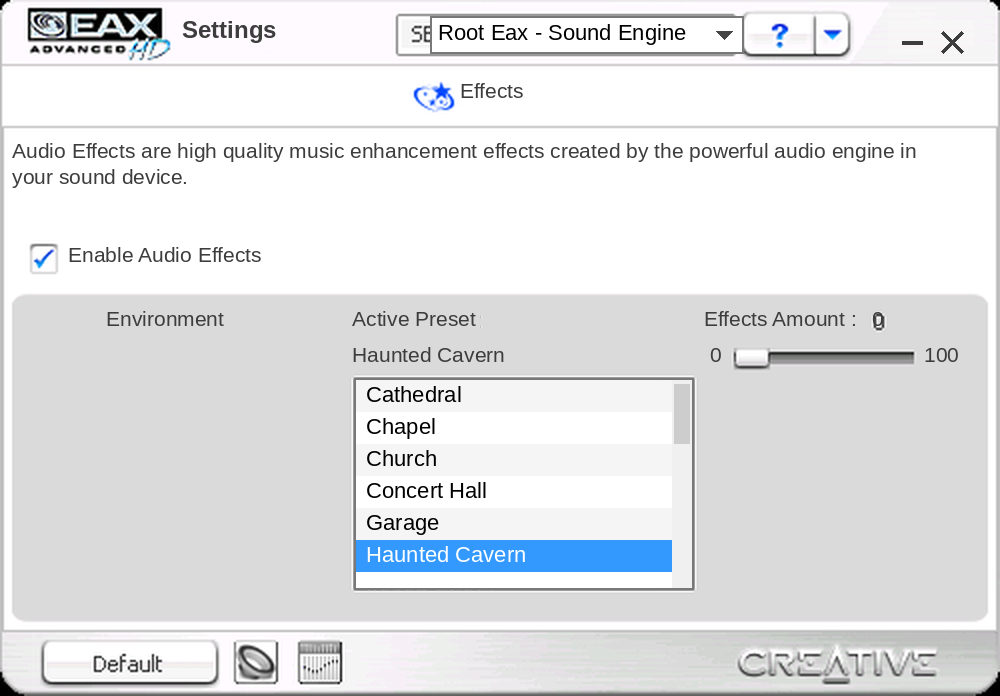
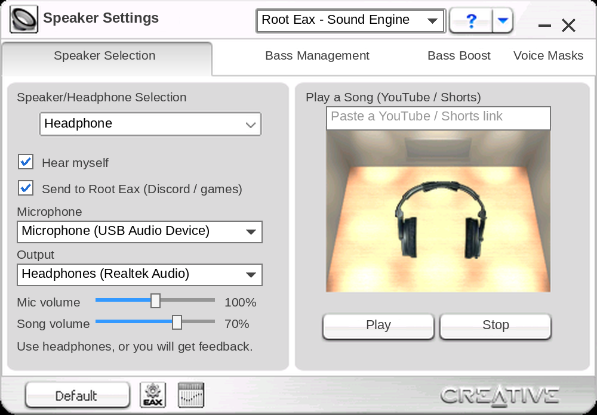
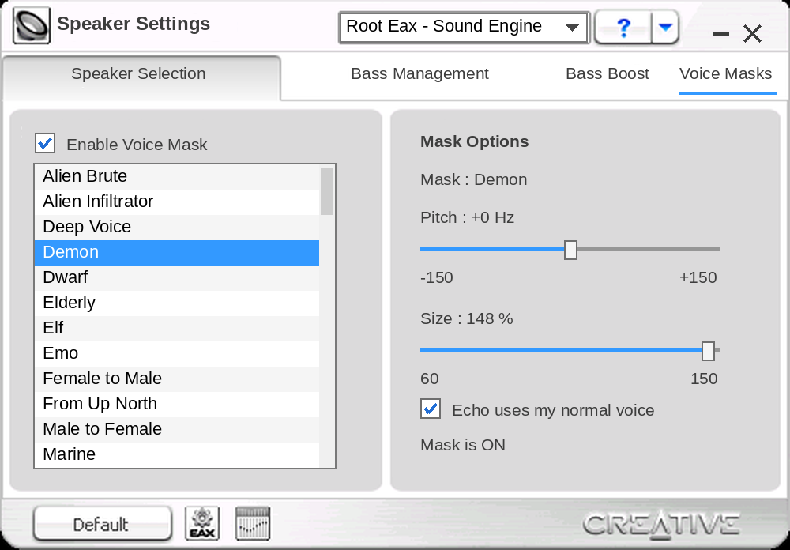
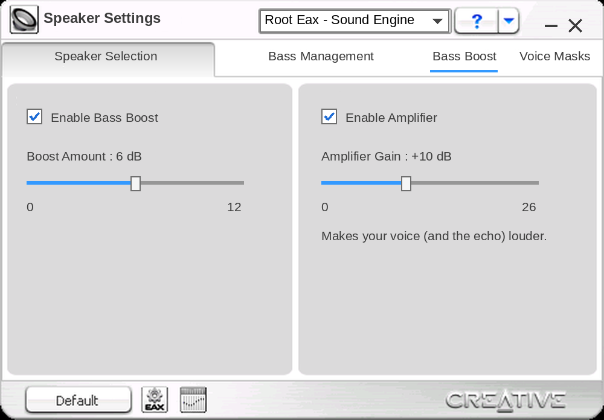
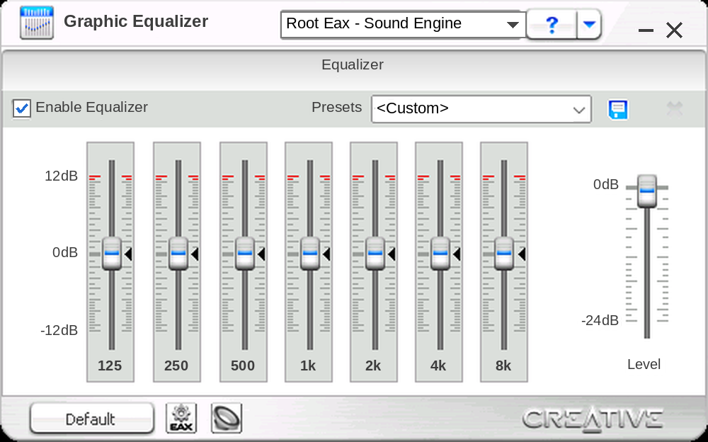
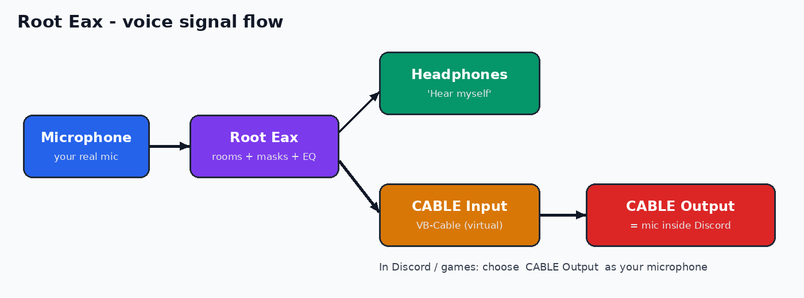
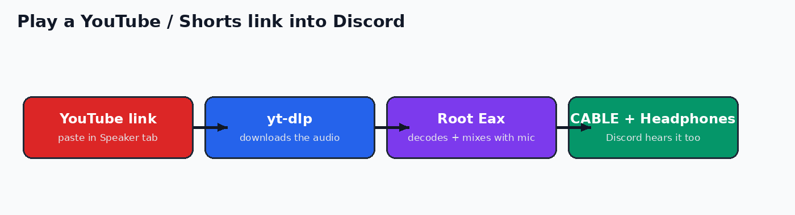

<div align="center">

# Root Eax

**Real-time microphone effects, room reverb, voice masks and a YouTube-to-Discord music player — in a classic sound-card style interface.**


</div>

---

## Table of Contents

1. [Screenshots](#screenshots)
2. [Features](#features)
3. [How it works](#how-it-works)
4. [Requirements](#requirements)
5. [Step 1 — Download Root Eax](#step-1--download-root-eax)
6. [Step 2 — Install VB-Cable](#step-2--install-vb-cable)
7. [Step 3 — Set up yt-dlp](#step-3--set-up-yt-dlp)
8. [Step 4 — Connect Root Eax to Discord / games](#step-4--connect-root-eax-to-discord--games)
9. [Usage guide](#usage-guide)
10. [Customizing the look](#customizing-the-look)
11. [Build from source](#build-from-source)
12. [Troubleshooting](#troubleshooting)
13. [Credits & License](#-credits--license)

---

## Screenshots

### Settings — rooms & effects



### Speaker — microphone, cable, songs



### Speaker — Voice Masks



### Speaker — Bass Boost & Amplifier



### Graphic Equalizer



---

## Features

| Feature | Description |
|---|---|
| **15 room environments** | Auditorium, Ball Park, Bathroom, Cathedral, Chapel, Church, Concert Hall, Garage, Haunted Cavern, Indoor Arena, Jazz Club, Living Room, Opera House, Small Room, Theater |
| **Effects Amount** | Control how strong the room effect is (0–100) while you talk |
| **Voice Masks** | Alien, Demon, Elf, Giant, Ghost, Robot-style and many more, with adjustable pitch and size |
| **Amplifier & Bass Boost** | Mic amplifier up to 26 dB and bass boost up to 12 dB |
| **Music from links** | Paste a YouTube / Shorts link and play it straight into Discord |
| **Graphic Equalizer** | 7-band equalizer with ready-made presets (Rock, Club, Dance, Full Bass, Live, Party…) |
| **Hear myself** | Monitor your processed voice in your headphones |
| **VB-Cable output** | Send the processed voice to any app that can pick a microphone |
| **Custom themes** | Your own background picture, accent color, light/dark text, square or rounded window |

---

## How it works

Root Eax takes your real microphone, runs it through the sound engine (rooms, masks, equalizer), and sends the result to your headphones and/or a **virtual cable**. Discord or your game then listens to the other end of that cable.



Songs work the same way — Root Eax downloads the audio with **yt-dlp**, mixes it with your voice and sends it through the cable too:



---

## Requirements

- **Windows 10 / 11 (64-bit)**
- A working **microphone**
- **VB-Cable** (free virtual audio cable) — only needed to send sound to Discord / games
- **Internet connection** — only needed for playing songs from links
- *Nothing else.* .NET is already packed inside the `.exe`, and yt-dlp is downloaded automatically.

---

## Step 1 — Download Root Eax

**Option A — Pre-built (recommended)**

1. Open the repository's **Actions** tab.
2. Click the latest successful **Build Root Eax** run.
3. Download the **`RootEax-win-x64`** artifact at the bottom of the page.
4. Unzip it — you get a single **`RootEax.exe`**. No installer needed.

```
Repo → Actions → Build Root Eax → latest run → Artifacts → RootEax-win-x64
```

**Option B — Build it yourself** → see [Build from source](#build-from-source).

> Windows SmartScreen may warn about an unknown publisher. Click **More info → Run anyway**.

---

## Step 2 — Install VB-Cable

VB-Cable creates a **virtual audio device** so other programs can "hear" Root Eax as if it were a microphone.

### 2.1 Download

1. Go to **https://vb-audio.com/Cable/**
2. Click the **Download** button and save the ZIP file.
3. **Extract** the ZIP to a folder (don't run it from inside the ZIP).

### 2.2 Install

1. Open the extracted folder.
2. **Right-click** `VBCABLE_Setup_x64.exe` → **Run as administrator**.
3. Click **Install Driver**.
4. Click **OK** when Windows confirms the installation.
5. **Restart your PC** (important — the cable will not show up without a restart).

```
Download ZIP   Extract   Run as administrator   Install Driver   Restart
```

### 2.3 Check that it worked

Open **Settings → System → Sound**. You should now see:

| Type | Device name |
|---|---|
| Output (playback) | **CABLE Input (VB-Audio Virtual Cable)** |
| Input (recording) | **CABLE Output (VB-Audio Virtual Cable)** |

> Root Eax looks for an output device with **"CABLE Input"** in its name. If it finds one, the option *Send to cable* becomes available in the Speaker window.

---

## Step 3 — Set up yt-dlp

yt-dlp is the tool that fetches the audio from YouTube / Shorts links.

### Automatic (default — nothing to do)

The first time you press **Play** on a link, Root Eax downloads `yt-dlp.exe` by itself and saves it here:

```
%AppData%\EAX\yt-dlp.exe
```

If a link fails because yt-dlp is out of date, Root Eax updates it once (`yt-dlp -U`) and retries automatically.

### Manual install (if the automatic download is blocked)

1. Open **https://github.com/yt-dlp/yt-dlp/releases/latest**
2. Download **`yt-dlp.exe`**.
3. Press <kbd>Win</kbd> + <kbd>R</kbd>, type `%AppData%\EAX` and press <kbd>Enter</kbd>.
   *(If the folder doesn't exist, run Root Eax once, or create it.)*
4. Copy `yt-dlp.exe` into that folder.

```
%AppData%\
└── EAX\
    ├── yt-dlp.exe      ← put it here
    ├── config.ini
    └── skin\
```

### Update manually (optional)

```powershell
cd $env:AppData\EAX
.\yt-dlp.exe -U
```

---

## Step 4 — Connect Root Eax to Discord / games

### In Root Eax

1. Open the **Speaker** window (the speaker icon in the bottom bar).
2. Under **Microphone**, choose your real microphone.
3. Tick **Send to cable (Discord / games)**.
4. *(Optional)* Tick **Hear myself** to monitor your voice — **use headphones**, otherwise you will get feedback.

### In Discord

1. **User Settings → Voice & Video**
2. **Input Device** → select **CABLE Output (VB-Audio Virtual Cable)**
3. Turn **off** *Automatic Input Sensitivity* if your voice gets cut, and turn off Discord's *Noise Suppression / Echo Cancellation* for the cleanest effect.

### In games / other apps

Choose **CABLE Output** as the microphone in the app's audio settings.

```
Root Eax (Speaker window)   Send to cable
Discord (Voice & Video)     Input Device: CABLE Output
```

---

## Usage guide

### 1) Settings window — rooms & effects

| Control | What it does |
|---|---|
| **Enable Audio Effects** | Turns the room effect on / off |
| **Environment** | Pick a room type |
| **Active Preset** | Pick the preset inside that room |
| **Effects Amount** | How strong the effect is |
| **Default** | Resets the page |

### 2) Speaker window

| Tab | What it does |
|---|---|
| **Speaker Selection** | Speaker layout (2 / 2.1 / 4 / 4.1 / 5.1 / 7.1 / Headphone), **Hear myself**, **Send to cable**, mic & output selection, mic volume, **song link + Play / Stop**, song volume |
| **Bass Management** | Bass management and the **Amplifier** |
| **Bass Boost** | Boost the low end of your voice |
| **Voice Masks** | Choose a mask, adjust pitch and size, option *Echo uses my normal voice* |

### 3) Playing a song

1. Open the **Speaker → Speaker Selection** tab.
2. Paste a YouTube or Shorts link in the box.
3. Press **Play**. Status shows *Loading…* then *Playing*.
4. Use **Song volume** to balance it against your voice.
5. Press **Stop** to end it.

> The song is sent to the cable automatically (if installed) and to your headphones, so your friends and you both hear it.

### 4) Graphic Equalizer

Open it from the equalizer icon in the bottom bar. Enable it, then pick a preset or drag the bands:

`Classical` · `Club` · `Dance` · `Full Bass` · `Full Treble` · `Headphones` · `Large Hall` · `Live` · `Party` · `Reggae` · `Rock` · `Soft` · `Soft Rock` · `Techno` …

---

## Customizing the look

Click the **small arrow** in the title bar to open the theme menu:

- **Choose background image…** / **Reset background**
- **Stretch / move image…**, **Stretch to fill**, **Keep proportions**
- **Text color:** Auto / Light / Dark / **Pick any color…**
- **Export skin images (to edit)**, **Open skin folder**, **Reload skin images**
- **Square window** (no rounded corners)
- **Reset everything (original look)**

Settings are saved in `%AppData%\EAX\config.ini`.

---

## Build from source

**Requirements:** Windows, [.NET 8 SDK](https://dotnet.microsoft.com/download/dotnet/8.0), Visual Studio Build Tools (MSVC, x64).

```bash
# 1) Build the native sound engine (run in "x64 Native Tools Command Prompt")
cd native\eaxcore
cl /nologo /LD /O2 /MT /EHsc /std:c++17 /utf-8 /DNOMINMAX /DNDEBUG eaxcore.cpp /Fe:..\..\src\RootEax\eaxcore.dll

# 2) Publish a single-file exe
cd ..\..
dotnet publish src/RootEax/RootEax.csproj -c Release -r win-x64 --self-contained true -p:PublishSingleFile=true -p:IncludeNativeLibrariesForSelfExtract=true -o out
```

Your build is at `out/RootEax.exe`.

> The GitHub Actions workflow (`.github/workflows/main.yml`) does exactly this on every push.

### Project structure

```
RootEax/
├── src/RootEax/          C# WinForms app (UI, themes, audio I/O, song player)
│   ├── UI/               Settings / Speaker / Equalizer windows
│   ├── Theme/            Skins & theming
│   └── Audio/            Engine (mic → effects → outputs) and Song (yt-dlp)
├── native/eaxcore/       C++ sound engine (reverb, voice masks, EQ…)
├── .github/workflows/    Automatic build
├── LICENSE
└── NOTICE
```

---

## Troubleshooting

| Problem | Fix |
|---|---|
| **"cable not installed"** shown in Speaker window | Install VB-Cable and **restart** the PC, then reopen Root Eax |
| Discord doesn't hear me | Make sure **Send to cable** is ticked and Discord's input is **CABLE Output** |
| Echo / feedback | Use headphones, or turn off **Hear myself** |
| *"Could not load this link"* | Check the link, your internet, or install/update yt-dlp manually (Step 3) |
| Song plays but friends can't hear it | Tick **Send to cable** and confirm Discord input is **CABLE Output** |
| Crackling sound | Close heavy apps; try a different microphone/output in the Speaker window |
| *"Sound engine not loaded"* | Use the official build — `eaxcore.dll` must be packed inside the exe |

---

## 👑 Credits & License

**Root Eax** © 2026 **Root** — all rights reserved under the terms of the [MIT License](LICENSE).

- 💻 Application & design: **Root**
- 🔊 Sound engine (`native/eaxcore`) includes third-party MIT-licensed code © 2026 Freemasonry — see `NOTICE`
- 🎵 [yt-dlp](https://github.com/yt-dlp/yt-dlp) — Unlicense
- 🔌 [VB-Cable](https://vb-audio.com/Cable/) © VB-Audio Software — donationware, not included in this repository
- 🎼 [NAudio](https://github.com/naudio/NAudio) — MIT

<div align="center">

**Made with ❤️ by Root**

</div>
